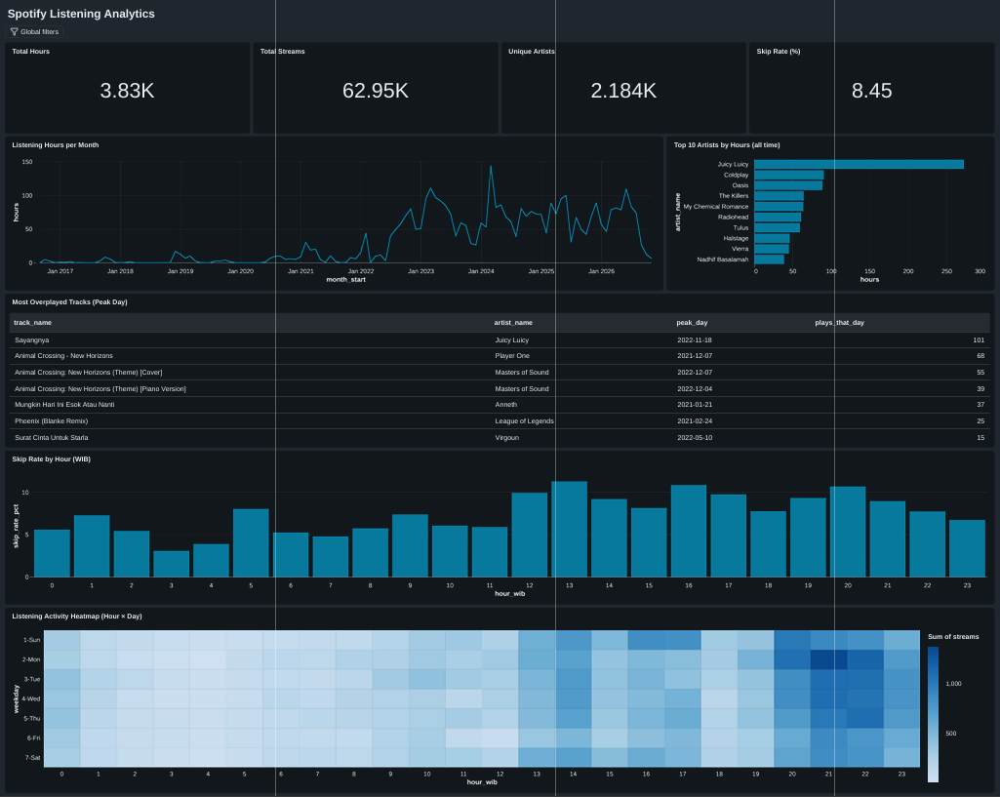
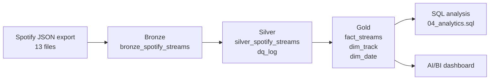
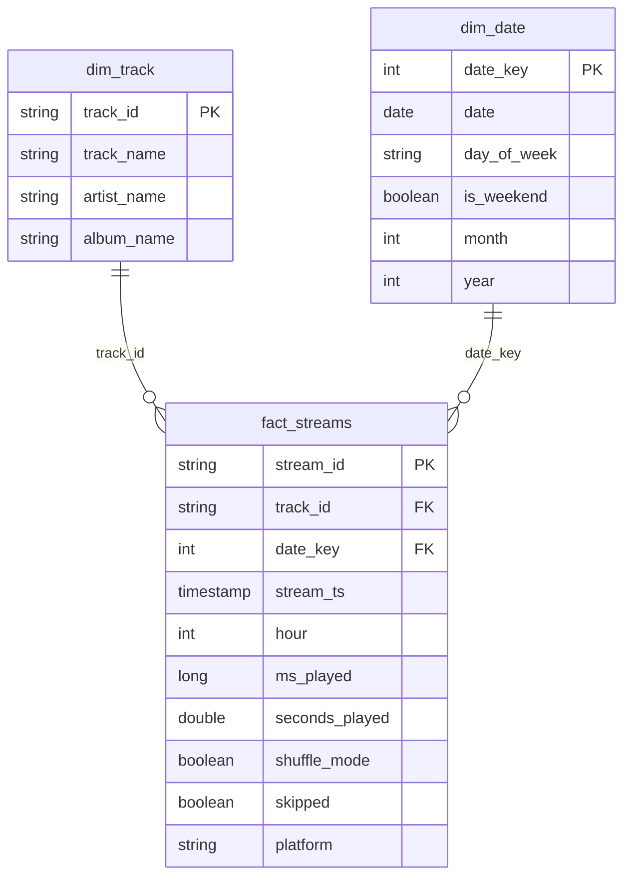

# Spotify Listening Analytics Pipeline

An end-to-end data pipeline on Databricks. It turns ten years of Spotify
streaming history (raw JSON) into a star schema and a dashboard.

**Stack:** Databricks (Free Edition), PySpark, Delta Lake, SQL, AI/BI Dashboards

## Contents

1. [Architecture](#1-architecture)
2. [Data model](#2-data-model)
3. [How to run](#3-how-to-run)
4. [Data quality checks](#4-data-quality-checks)
5. [Key findings](#5-key-findings)
6. [Design decisions](#6-design-decisions)
7. [Limitations and next steps](#7-limitations-and-next-steps)

## 1. Architecture

| Layer | Notebook | Tables | What happens |
|---|---|---|---|
| Landing | manual upload | Volume `spotify_raw` | Raw JSON files are uploaded as they are. |
| Bronze | `01_bronze.py` | `bronze_spotify_streams` | Read JSON with an explicit schema. Add `ingestion_timestamp` and `source_filename`. Append to Delta. No cleaning. |
| Silver | `02_silver.py` | `silver_spotify_streams`, `dq_log` | Parse timestamps, filter, deduplicate, add year, month, day and hour. Log row counts for each rule. |
| Gold | `03_gold.py` | `fact_streams`, `dim_track`, `dim_date` | Build the star schema. Run `OPTIMIZE ... ZORDER BY (date_key)`. |
| Analytics | `04_analytics.sql` | none | Three business questions answered in SQL. |
| Dashboard | Databricks AI/BI | none | Nine widgets that query the Gold tables. |

The dashboard has its own SQL datasets. It does not run `04_analytics.sql`.

## 2. Data model

Star schema. One row in `fact_streams` is one play of one track.

- `track_id` is the last part of `spotify_track_uri`.
- `stream_id` is a SHA-256 hash of the timestamp and track URI, so it is deterministic.
- `dim_date` is generated from the first to the last date in the data, so days without plays still have a row.
- Artist and album live inside `dim_track` (denormalized). This keeps queries simple.

## 3. How to run

### Prerequisites

- A Databricks workspace (Free Edition works).
- Either your own Spotify Extended Streaming History, or the synthetic data from this repo.

### Steps

1. In Databricks, go to **Workspace**, then **Import**, and import every file in `notebooks/`.
2. Create a Volume named `spotify_raw` (catalog `workspace`, schema `default`).
3. Add data:
   - **Own data:** request *Extended streaming history* at spotify.com/account/privacy, then upload the `Streaming_History_Audio_*.json` files to the Volume.
   - **Synthetic data:** run `00_generate_sample_data.py`. It writes a sample file with the same structure, including short plays, NULLs and duplicates.
4. If your path differs, change `RAW_PATH` in `01_bronze.py`.
5. Run the notebooks in order: `01_bronze`, `02_silver`, `03_gold`, `04_analytics`.
6. To rebuild the dashboard, create the datasets from the queries in `04_analytics.sql` and the dashboard section below.

Notebooks use the Databricks source format (`.py` with `# COMMAND ----------` markers).

### Privacy

Raw listening history is personal data. This repo contains no real data. The `.gitignore` blocks JSON, CSV and Parquet files. IP address and user agent columns are not read at all.

## 4. Data quality checks

Implemented in `02_silver.py`. Each step writes its row counts to the table `dq_log`.

| # | Check | Rule |
|---|---|---|
| 1 | Valid timestamp | `ts` parses to `TimestampType` and is not NULL |
| 2 | Micro-plays | Drop rows with `ms_played < 30000` |
| 3 | Missing metadata | Drop rows where track name, artist name or track URI is NULL or empty. This removes podcasts. |
| 4 | Duplicates | `dropDuplicates(["ts_utc", "track_uri"])` |
| 5 | Defaults | NULL `album_name` becomes `Unknown Album`. NULL `skipped` and `shuffle` become `false`. |

Results from the real run:

| Check | Rows before | Rows after | Dropped |
|---|---|---|---|
| Valid timestamp | 73205  | 73205  | 0 |
| ms_played >= 30000 | 73205  | 63028 | 10177 |
| Track and artist not NULL | 63028 | 62987 | 41 |
| Deduplication | 62987 | 62950 | 37 |

The final Silver table has about 62,950 rows.

## 5. Key findings

All numbers come from the author's own listening history (2016 to 2026).

### Overview

| Metric | Value |
|---|---|
| Total listening time | about 3,830 hours |
| Total streams (after cleaning) | about 62,950 |
| Unique artists | about 2,180 |
| Skip rate | 8.45% |

### Q1. Top 5 artists by listening hours (last 3 months in the data)

| Rank | Artist | Hours | Plays | Avg minutes per play |
|---|---|---|---|---|
| 1 | Al Sheikh Badr Al Turki | 13.00 | 46 | 17.0 |
| 2 | Radiohead | 8.55 | 119 | 4.3 |
| 3 | My Chemical Romance | 3.58 | 57 | 3.8 |
| 4 | The 1975 | 2.73 | 34 | 4.8 |
| 5 | Oasis | 2.32 | 28 | 5.0 |

The top artist leads by hours but not by plays. Each play lasts about 17 minutes, against 4 to 5 minutes for the others. Ranked by plays, Radiohead is first.

### Q2. Skip rate by hour of day (shown in WIB, UTC+7)

| Metric | Hour (WIB) | Skip rate | Streams |
|---|---|---|---|
| Highest | 13:00 | 11.28% | 3,555 |
| 2nd highest | 16:00 | 10.85% | 3,862 |
| 3rd highest | 20:00 | 10.68% | 5,812 |
| Lowest | 03:00 | 3.07% | 391 |
| 2nd lowest | 04:00 | 3.89% | 257 |
| Busiest hour | 21:00 | 8.95% | 7,193 |

All hours fall between about 3% and 11%. The 20:00 peak sits next to the busiest listening period, so it is the most reliable pattern. The lowest rates are at 03:00 and 04:00, but those hours have fewer than 400 streams, so they are weak evidence. Streams under 30 seconds were removed in Silver, so absolute rates are understated. Only the order between hours should be trusted.

### Q3. Most overplayed tracks (more than 10 plays on one day)

| Rank | Track | Artist | Peak day | Plays that day |
|---|---|---|---|---|
| 1 | Sayangnya | Juicy Luicy | 2022-11-18 | 101 |
| 2 | Animal Crossing - New Horizons | Player One | 2021-12-07 | 68 |
| 3 | Animal Crossing: New Horizons (Theme) [Cover] | Masters of Sound | 2022-12-07 | 55 |

"Sayangnya" was also played 71 times the day before. Counts this high usually mean one track on repeat.

### Dashboard observations

- Listening is busiest between 20:00 and 22:00 WIB, especially on Wednesday and Thursday. A second band appears around 13:00 to 14:00.
- Monthly listening hours rise from 2021, with a peak in early 2024.
- The last month in the line chart is partial, because the data ends in mid-November. It is not a real drop.
- All-time, Juicy Luicy has the most listening hours.

## 6. Design decisions

- **File export instead of the Spotify API.** The API returns only about the last 50 plays and has no `ms_played` or `skipped`. It cannot answer the business questions.
- **Explicit schema in Bronze.** It avoids type guessing and keeps the raw layer stable.
- **IP address and user agent are not ingested.** They are personal data and not needed.
- **Bronze is append-only.** Reruns can create duplicates. Silver removes them.
- **Silver is overwritten on each run.** It can always be rebuilt from Bronze.
- **Dimensions are overwritten on each run.** Track attributes rarely change, so this is effectively SCD Type 1.
- **Hours stored in UTC.** The dashboard converts to Asia/Jakarta at query time.

## 7. Limitations and next steps

Limitations:

- Dropping streams under 30 seconds removes most real skips, so the skip rate is understated.
- Older records often have `skipped` as NULL. These are treated as not skipped.
- `OPTIMIZE ZORDER` has no visible effect on a table this small. It is included to show the technique.

Next steps:

- Schedule the notebooks with Databricks Jobs.
- Use Auto Loader for incremental ingestion of new files.
- Add `dim_artist`, surrogate keys and explicit constraints.
- Try liquid clustering (`CLUSTER BY`) instead of Z-ORDER.
- Add the Spotify Web API as a second source for recent plays.

## License

MIT. See `LICENSE`.
